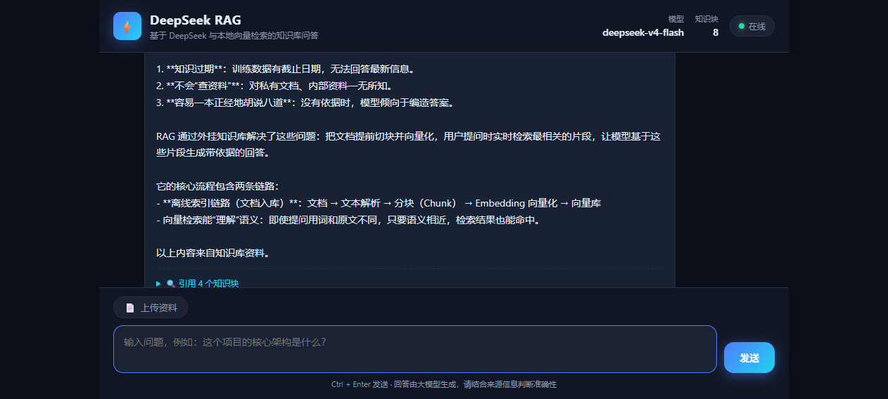

# DeepSeek RAG QA

一个基于 **DeepSeek 兼容 API + 本地向量检索（RAG）** 的智能问答机器人。

上传知识文档后，系统会自动完成：**文本切块 → 本地 Embedding → 向量检索 Top-K → 大模型生成带引用的回答**。适合快速搭建企业知识库问答、个人文档助理，以及作为 **Python 后端 / AI 应用 / LLM 实习岗位** 的项目作品。

---

## ✨ 功能特性

- 📚 **多格式知识入库**：支持 `.txt / .md / .pdf / .docx`，可通过 API 或命令行导入
- 🔍 **本地向量检索**：使用 `BAAI/bge-small-zh-v1.5`（512 维）+ 自研 NumPy 向量库，不依赖外部 Embedding 服务
- 🤖 **LLM 生成回答**：接入 OpenAI 兼容接口，模型 `deepseek-v4-flash`
- 🧠 **中文优化**：切块器按中文标点优先切分，回答风格面向中文用户
- 💬 **会话记忆**：SQLite 保存聊天记录，可切换 MySQL
- 🌐 **Web UI**：原生暗色聊天界面，开箱即用
- 🚀 **FastAPI 后端**：REST API 清晰，方便二次开发与部署

---

## 🖼️ 演示

> 
>
> 上图展示了真实的问答交互：输入问题后，系统检索知识库并生成带引用的中文回答。

CLI 端到端演示：

```bash
# Windows
.venv\Scripts\python.exe scripts\demo.py

# Linux / macOS
python scripts/demo.py
```

---

## 🧱 技术栈

| 分类 | 技术 |
|---|---|
| 后端 | Python 3.10、FastAPI、Uvicorn、Pydantic-settings |
| LLM | OpenAI SDK、LangChain `ChatOpenAI` |
| 模型 | `deepseek-v4-flash`（对话）、`BAAI/bge-small-zh-v1.5`（本地向量） |
| 向量检索 | FastEmbed + NumPy 向量库（余弦相似度 + JSON 持久化） |
| 存储 | SQLAlchemy、SQLite（默认）、MySQL（可选） |
| 文档解析 | pypdf、python-docx |
| 前端 | 原生 HTML / CSS / JavaScript |

---

## 🚀 快速开始

### 环境要求

- Python 3.10+
- Windows / macOS / Linux
- 可访问 OpenAI 兼容接口的网络环境

### 1. 克隆项目

```bash
git clone <your-repo-url>
cd deepseek-rag-qa
```

### 2. 配置环境变量

复制 `.env.example` 为 `.env`，填入真实 API Key：

```bash
cp .env.example .env
```

```ini
LLM_BASE_URL=https://tokenrhythm.studio/v1
LLM_API_KEY=your-real-api-key
LLM_MODEL=deepseek-v4-flash
HF_ENDPOINT=https://hf-mirror.com
HF_HUB_DISABLE_XET=1
```

> ⚠️ `.env` 已被 `.gitignore` 忽略，**真实密钥严禁提交到 git**。

### 3. 安装依赖并启动

#### Windows

```bat
scripts\run.bat
```

#### 手动启动

```bash
python -m venv .venv
source .venv/bin/activate   # Windows: .venv\Scripts\activate
pip install -r requirements.txt
python -m uvicorn app.main:app --host 0.0.0.0 --port 8000
```

打开 <http://127.0.0.1:8000> 即可使用 Web UI。

### 4. 导入知识文档

把文件放到 `data/knowledge/` 后重启，或在服务启动后调用 API 上传：

```bash
python scripts/ingest.py data/knowledge
```

也支持单文件：

```bash
python scripts/ingest.py path/to/document.pdf
```

---

## 🔌 API 说明

### 健康检查

```http
GET /api/health
```

响应示例：

```json
{
  "status": "ok",
  "chunk_count": 8
}
```

### 知识库统计

```http
GET /api/stats
```

### 上传文档入库

```http
POST /api/ingest
Content-Type: multipart/form-data

file: <your-document>
```

支持 `.txt / .md / .markdown / .pdf / .docx`，单文件最大 10MB。

### RAG 问答

```http
POST /api/chat
Content-Type: application/json
```

请求体：

```json
{
  "message": "RAG 是什么？",
  "session_id": "test-session"
}
```

响应示例：

```json
{
  "answer": "RAG（Retrieval-Augmented Generation）是一种……",
  "sources": [
    {
      "source": "rag-intro.md",
      "score": 0.5974,
      "text": "……（知识块内容截断，前 200 字）"
    }
  ],
  "session_id": "test-session"
}
```

> 注意：`sources[].text` 为知识块内容截断（前 200 字），`score` 为余弦相关度（0~1）。

### 会话历史

```http
GET /api/sessions/{session_id}/messages
```

---

## 📁 项目结构

```
deepseek-rag-qa/
├── app/
│   ├── main.py              # FastAPI 入口与 API 路由
│   ├── config.py            # 环境变量配置
│   ├── database.py          # 数据库引擎
│   ├── models.py            # ORM 模型
│   └── rag/
│       ├── embeddings.py    # 本地 Embedding
│       ├── vectorstore.py   # 向量库持久化
│       ├── chunker.py       # 文本切块
│       ├── loader.py        # 文档解析
│       └── pipeline.py      # RAG 核心管线
├── data/
│   ├── knowledge/           # 示例知识库
│   ├── vector_index/        # 向量索引（自动生成）
│   ├── models/              # 本地模型缓存
│   └── chat.db              # 聊天记录
├── scripts/
│   ├── run.bat              # Windows 一键启动
│   ├── demo.py              # 端到端演示
│   ├── ingest.py            # 命令行导入
│   └── smoke_utf8.py        # UTF-8 API 冒烟测试
├── tests/                   # pytest 单元 + API 测试
├── web/                     # 前端 UI
├── .github/workflows/       # GitHub Actions CI
├── .env.example             # 环境变量模板
├── requirements.txt
├── requirements-dev.txt     # 测试依赖
└── HANDOFF.md               # 开发者交接文档
```

---

## ⚙️ 环境变量

| 变量 | 默认值 | 说明 |
|---|---|---|
| `LLM_BASE_URL` | 无 | OpenAI 兼容接口地址 |
| `LLM_API_KEY` | 无 | 真实密钥，仅放 `.env` |
| `LLM_MODEL` | `deepseek-v4-flash` | 对话模型 |
| `LLM_TEMPERATURE` | `0.3` | 生成温度 |
| `LLM_MAX_TOKENS` | `1024` | 最大生成 token |
| `EMBEDDING_MODEL` | `BAAI/bge-small-zh-v1.5` | 本地向量模型 |
| `EMBEDDING_DIM` | `512` | 向量维度 |
| `TOP_K` | `4` | 检索召回数量 |
| `CHUNK_SIZE` | `500` | 切块大小 |
| `CHUNK_OVERLAP` | `80` | 切块重叠 |
| `HF_ENDPOINT` | `https://hf-mirror.com` | HuggingFace 镜像 |
| `HF_HUB_DISABLE_XET` | `1` | 禁用 HF Xet 下载 |
| `DATA_DIR` | `./data` | 数据目录 |
| `CHAT_DB_URL` | `sqlite:///./data/chat.db` | 数据库连接串 |

---

## 🐳 Docker 部署

```bash
docker compose up --build -d
```

服务默认运行在 <http://localhost:8000>。

> Docker 相关文件位于仓库根目录：`Dockerfile`、`docker-compose.yml`、`.dockerignore`。

---

## 🗺️ Roadmap

- [ ] 添加更多文档格式（Excel、HTML、Markdown 图片 OCR）
- [ ] 增加 rerank 精排，提升检索质量
- [ ] 支持知识库多租户 / 多分类
- [ ] 接入流式输出（SSE）
- [ ] 前端增加会话管理 / 文件管理页面
- [x] 自动化测试与 CI（pytest + GitHub Actions）
- [ ] 部署上线

---

## 📞 联系方式

- 姓名：刘勇琨
- 邮箱：2291934347@qq.com
- GitHub：https://github.com/xiazhiaidao

---

## 📄 License

MIT